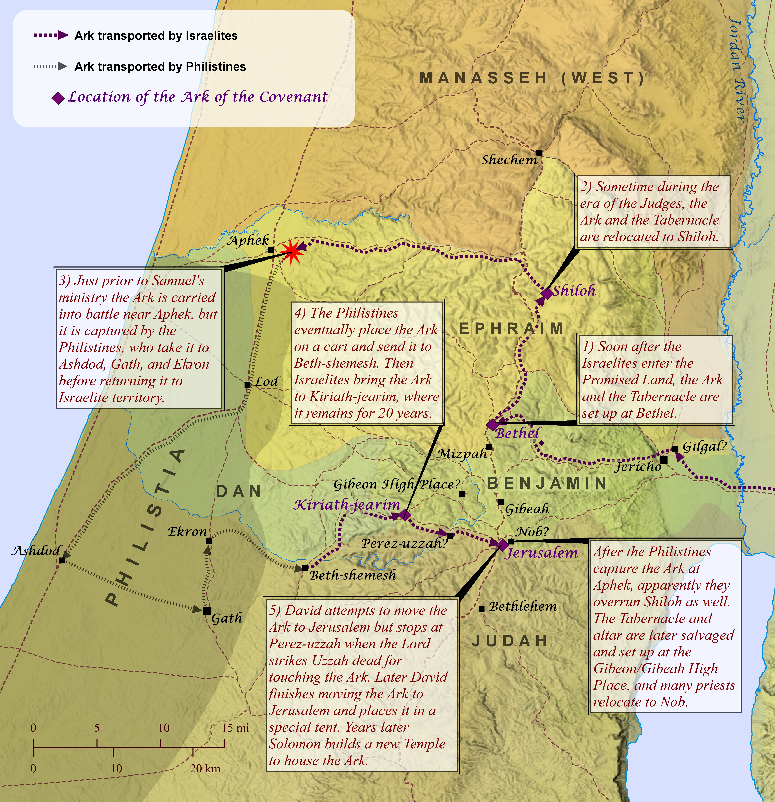

<i>The Silent Disappearance of the Ark of the Covenant from the Old Testament?</i>

During one of my daily Bible readings, I came across this passage in Jeremiah: <!--more-->

> 12In the fifth month, on the tenth day of the month—which was the nineteenth year of King Nebuchadrezzar, king of Babylon—Nebuzaradan the captain of the bodyguard who served the king of Babylon, entered Jerusalem. 13He burned the house of the Lord, the king's house, and all the houses of Jerusalem; every great house he burned down. 14All the army of the Chaldeans, who were with the captain of the guard, broke down all the walls around Jerusalem. 15Nebuzaradan the captain of the guard carried into exile some of the poorest of the people and the rest of the people who were left in the city and the deserters who had defected to the king of Babylon, together with the rest of the artisans. 16But Nebuzaradan the captain of the guard left some of the poorest people of the land to be vinedressers and tillers of the soil.

> 17The pillars of bronze that were in the house of the Lord, and the stands and the bronze sea that were in the house of the Lord, the Chaldeans broke in pieces, and carried all the bronze to Babylon. 18They took away the pots, the shovels, the snuffers, the basins, the ladles, and all the vessels of bronze used in the temple service. 19The captain of the guard took away the small bowls also, the firepans, the basins, the pots, the lampstands, the ladles, and the bowls for libation, both those of gold and those of silver. 20As for the two pillars, the one sea, the twelve bronze bulls that were under the sea, and the stands, which King Solomon had made for the house of the Lord, the bronze of all these vessels was beyond weighing. 21As for the pillars, the height of the one pillar was eighteen cubits, its circumference was twelve cubits; it was hollow and its thickness was four fingers. 22Upon it was a capital of bronze; the height of the capital was five cubits; latticework and pomegranates, all of bronze, encircled the top of the capital. And the second pillar had the same, with pomegranates. 23There were ninety-six pomegranates on the sides; all the pomegranates encircling the latticework numbered one hundred. (Jeremiah 52:12-23 NRSV)

While reading this, I suddenly realized that something was missing from the list of the items taken from the Temple by Nebuzaradan: the Ark of the Covenant. There is no mention of it at all. I found this puzzling: this Ark was the symbol of the covenant between God and Israel. Why would it not be mentioned here? Surely, this would be a massive trophy for Nebuzaradan. What was the fate of the Ark of the Covenant? I decided to trace its whereabouts through the Old Testament.

The Ark of the Covenant is part of the instruction of building the Tabernacle in Exodus 25. It is a wooden box, made of acacia wood, approximately 114 cm x 69 cm x 69 cm. It was overlaid with pure gold, with rings attached through which 2 poles could be placed to carry the Ark on Israel's journeys.

The importance of the Ark becomes clear when God dictates that:

> You shall make two cherubim of gold; you shall make them of hammered work, at the two ends of the mercy seat. 19Make one cherub at the one end, and one cherub at the other; of one piece with the mercy seat you shall make the cherubim at its two ends. 20The cherubim shall spread out their wings above, overshadowing the mercy seat with their wings. They shall face one to another; the faces of the cherubim shall be turned toward the mercy seat. 21You shall put the mercy seat on the top of the ark; and in the ark you shall put the covenant that I shall give you. 22There I will meet with you, and from above the mercy seat, from between the two cherubim that are on the ark of the covenant, I will deliver to you all my commands for the Israelites. (Exodus 25:18-22)

The Ark of the Covenant was thus the place where God would meet his people, it is His throne. During Israel's journeys the Ark would go before them (Numbers 10:33), and the people would follow. It went with Israel to the Holy Land.

When Israel arrives in the Holy Land, the Tabernacle and in it the Ark are set up in Shiloh (Joshua 18:1) as well as in Bethel (Judges 20:27). The Ark becomes one of the main characters in the books of Samuel. During battle, it is used by Israel as a some sort of mascot, a 'portable god,' to bring them luck in the battles with the Philistines. This ends in disaster and the Ark is taken by their enemies. After a while, the Ark is returned to Israel, because God brings disaster over the Philistines. After some intermediate stops, the Ark finally moves to Jerusalem, in a special tent David had made for it (2 Samuel 6:17). Interestingly enough, the Tabernacle itself was not brought to Jerusalem! It remained in Gibeon (1 Chronicles 21:29). When Solomon finished the construction of the Temple of the Lord, the Ark is brought into the Most Holy Place inside the Temple (2 Chronicles 5:7, and much later again in 2 Chronicles 35:3). From then onwards, we do not hear anything about the Ark itself anymore.

The picture below shows the travels the Ark made in the Holy Land ([source](https://biblemapper.com/blog/index.php/2023/03/11/the-ark-of-the-covenant-in-the-promised-land/)):

So, after all this wanderings, this is where we are left. The Ark is in the Temple, and that is all we know. Of its fate, nothing more is told. Or is it?

There is one prophecy left…

And that is in Jeremiah itself as well. Jeremiah 3:15-17 reads (NRSV):

> 15I will give you shepherds after my own heart, who will feed you with knowledge and understanding. 16And when you have multiplied and increased in the land, in those days, says the Lord, they shall no longer say, "The ark of the covenant of the Lord." **It shall not come to mind, or be remembered, or missed; nor shall another one be made.** 17At that time Jerusalem shall be called the throne of the Lord, and all nations shall gather to it, to the presence of the Lord in Jerusalem, and they shall no longer stubbornly follow their own evil will.

God Himself says that there will be times that the Ark will not be remembered anymore, nor missed. This is so fitting to how the Ark disappears from our sight in the Old Testament. For me, it demonstrates how God is at work in the Old Testament, working towards the salvation of His people, both in Israel and beyond. We do not need the Ark anymore as the throne of God. Jerusalem shall be His throne. It reminds me of one of the most beautiful passages of the New Testament:

> **21** Then I saw a new heaven and a new earth; for the first heaven and the first earth had passed away, and the sea was no more. 2And I saw the holy city, the new Jerusalem, coming down out of heaven from God, prepared as a bride adorned for her husband. 3And I heard a loud voice from the throne saying,  
>"See, **the home of God is among mortals**.  
>He will dwell with them as their God;  
>they will be his peoples,  
>and God himself will be with them;  
>4he will wipe every tear from their eyes.  
>Death will be no more;  
>mourning and crying and pain will be no more,  
>for the first things have passed away."  
>5And the one who was seated on the throne said, "See, I am making all things new."  
>(Revelation 21:1-5, NRSV).

We are longing for this new Jerusalem, where God will be among us, dwell with us as our God. What a bright future that is!
